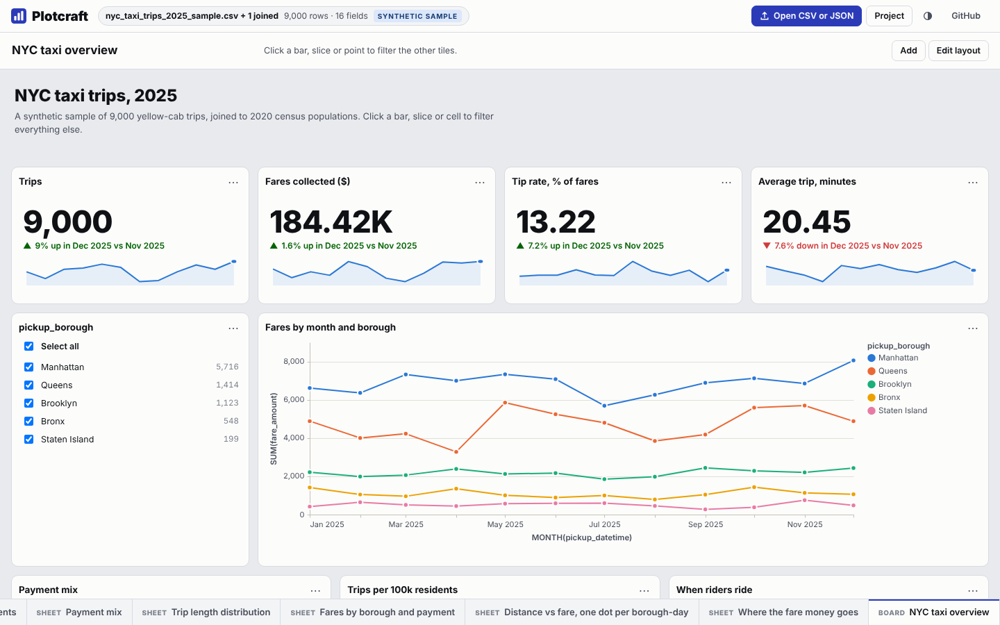
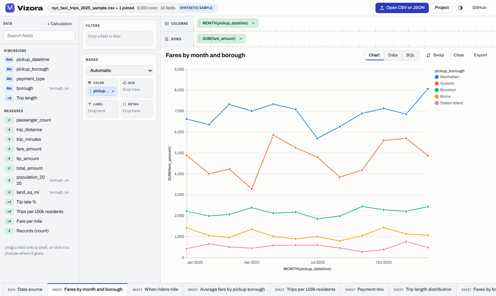
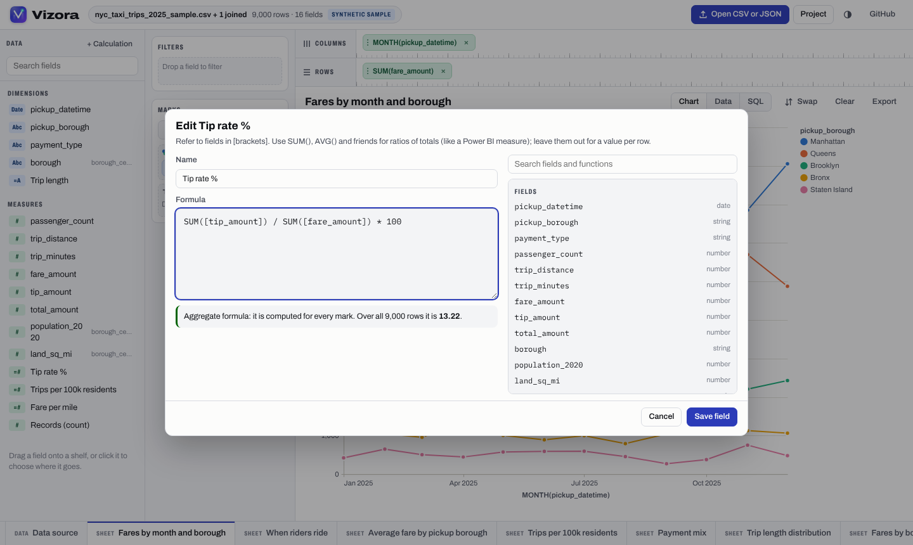
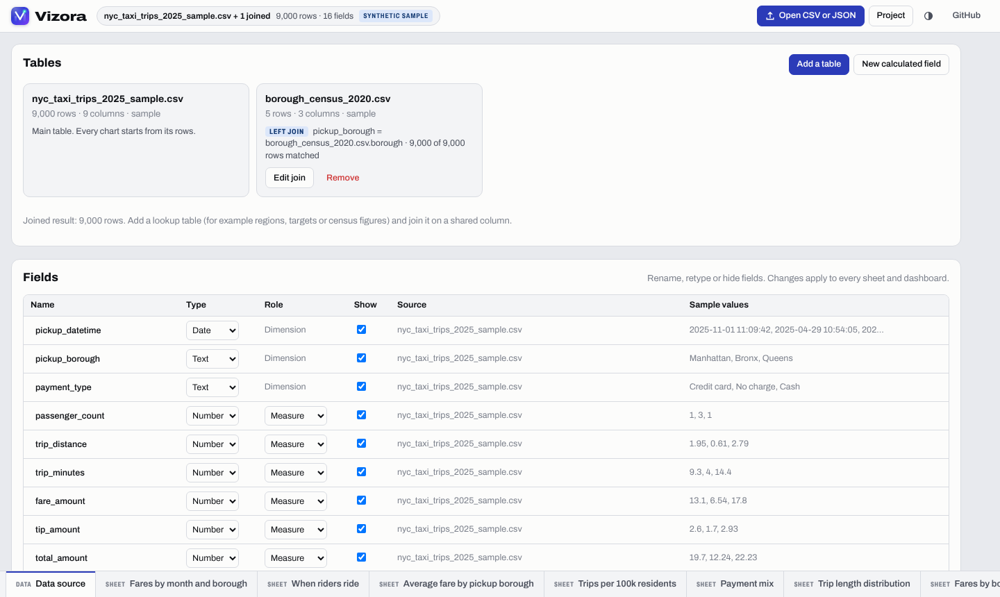
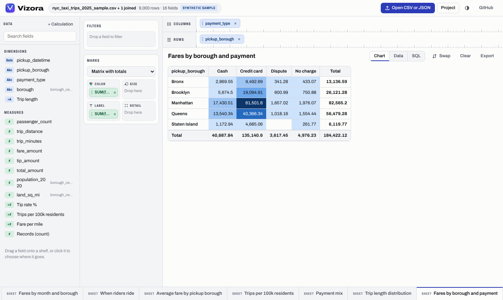
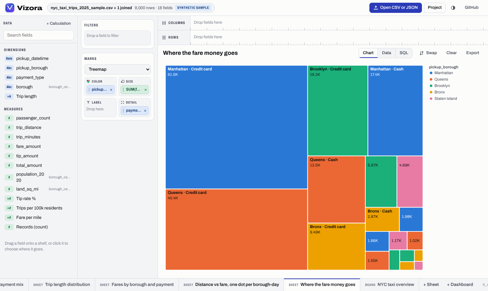
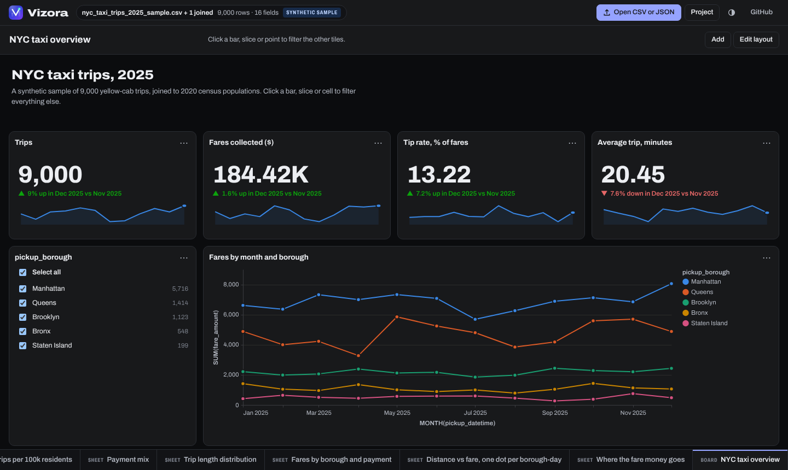

<p align="center">
  
</p>

<h1 align="center">Vizora</h1>

<p align="center">
  <b>Tableau-style charts and Power BI-style dashboards, free and open source, running entirely in your browser.</b>
</p>

<p align="center">
  Drop in a CSV, drag fields onto shelves, write calculated fields, join tables and build interactive dashboards with slicers and cross-filtering. No install, no account, no server: your data never leaves your device.
</p>

<p align="center">
  
  
  
  
  
</p>

<p align="center">
  <a href="https://vizora.zayeedbinkabir.com"><b>Open Vizora</b></a> ·
  <a href="#features">Features</a> ·
  <a href="#downloads">Downloads</a> ·
  <a href="#get-started">Run it locally</a> ·
  <a href="#under-the-hood">How it works</a> ·
  <a href="#roadmap">Roadmap</a>
</p>

<p align="center">
  <a href="https://vizora.zayeedbinkabir.com"></a>
  <br>
  <i>The built-in sample dashboard: 9,000 synthetic NYC taxi trips joined to 2020 census populations. Click any bar, slice or cell to filter everything else.</i>
</p>

> [!NOTE]
> Vizora opens with a sample project so you can click around right away. Use **Open CSV or JSON** to load your own data; it stays in your browser.

---

### 🧲 Drag, drop, done
Columns, Rows, Color, Size, Label, Detail and Filters shelves work the way Tableau users expect. Vizora picks a sensible chart automatically, and you can override it anytime.

### 📊 Dashboards that talk to each other
A 12-column canvas with KPI cards, slicers, text and any sheet. Click a mark and every other tile cross-filters, the way Power BI does it.

### 🧮 A real formula language
Row-level and aggregate calculated fields with 45+ functions, type checking as you type, and a live preview. Think Tableau calcs and DAX measures in one place.

### 🔒 Private by default
Everything runs client-side. Projects save to your browser's IndexedDB, and nothing is uploaded anywhere.

## Features

<table>
  <tr>
    <td width="50%" valign="top">
      <a href="docs/worksheet.png"></a>
      <h4>Shelves and automatic charts</h4>
      Drag a date onto Columns and a measure onto Rows and you get a timeline. Add a dimension to Color and it splits into series. Text fields become categories, numbers and dates become axes.
    </td>
    <td width="50%" valign="top">
      <a href="docs/calculated-field.png"></a>
      <h4>Calculated fields</h4>
      <code>IF [trip_distance] >= 10 THEN "Long" ELSE "Short" END</code> or <code>SUM([tip_amount]) / SUM([fare_amount]) * 100</code>. Errors point at the exact spot, and the preview updates as you type.
    </td>
  </tr>
  <tr>
    <td width="50%" valign="top">
      <a href="docs/data-source.png"></a>
      <h4>Data model and joins</h4>
      Add lookup tables and join them (left or inner) on a shared column, like a Power BI relationship. Rename, retype, hide or switch any field between dimension and measure, and every sheet updates.
    </td>
    <td width="50%" valign="top">
      <a href="docs/matrix.png"></a>
      <h4>Matrix with totals</h4>
      A Power BI-style matrix with row, column and grand totals plus conditional heat shading. Every view also has <b>Data</b> and <b>SQL</b> tabs.
    </td>
  </tr>
  <tr>
    <td width="50%" valign="top">
      <a href="docs/treemap.png"></a>
      <h4>Pie, donut and treemap</h4>
      Part-to-whole views alongside bar, line, area, scatter, heatmap, text table, tick and gauge. Labels choose a readable color for each fill.
    </td>
    <td width="50%" valign="top">
      <a href="docs/dashboard-dark.png"></a>
      <h4>Light and dark</h4>
      Both themes use a colorblind-checked palette. On a phone, dashboards stack into a single column.
    </td>
  </tr>
</table>

## Everything in the box

#### 📈 13 visual types
Bar · line · area · circle (scatter) · square (heatmap) · text table · tick · pie · donut · treemap · matrix · KPI card · gauge

#### 🧰 Shelves and pills
Columns · Rows · Color · Size · Label · Detail · Filters. Aggregations: sum, average, median, min, max, count, count distinct. Dates as continuous timelines (year, quarter, month, week, day) or discrete parts (month of year, weekday, hour). Bins and one-click histograms for any number field. Sort by value, small multiples, swap rows and columns.

#### 🎛️ Dashboard canvas
Drag to move, pull the corner to resize, tiles push each other out of the way. Tiles: sheets, KPI cards (value, sparkline, change vs the previous period), slicers (checkbox lists with counts), text. Click-to-cross-filter on every chart.

#### 🧮 Formula language
Logic: `IF / ELSEIF / ELSE`, `AND`, `OR`, `NOT`, `IIF`, `ZN`, `IFNULL`, `ISNULL`. Math: `ABS`, `ROUND`, `FLOOR`, `CEILING`, `SQRT`, `POWER`, `LOG`, `LN`, `EXP`, `SIGN`, `DIV`, `MIN`, `MAX`. Text: `UPPER`, `LOWER`, `TRIM`, `LEFT`, `RIGHT`, `MID`, `LEN`, `CONTAINS`, `STARTSWITH`, `ENDSWITH`, `REPLACE`, `STR`. Dates: `DATEPART`, `DATETRUNC`, `DATEDIFF`, `DATEADD`, `MAKEDATE`, `YEAR`, `QUARTER`, `MONTH`, `DAY`, `HOUR`, `WEEKDAY`. Aggregates: `SUM`, `AVG`, `MEDIAN`, `COUNT`, `COUNTD`, `MIN`, `MAX`.

#### 🗂️ Data in, data out
CSV, TSV and JSON in. Types are detected automatically, including currency text like `"$1,200.50"` and US dates like `1/5/2024`. Export charts as PNG or SVG, tables as CSV, and whole workbooks as `.vizora.json` (with or without the data).

## Downloads

Vizora runs three ways. They're all the same app, and none of them sends your data anywhere.

### 🌐 In your browser
Open **[vizora.zayeedbinkabir.com](https://vizora.zayeedbinkabir.com)**. Nothing to install.

### 📌 As an installed web app
In Chrome or Edge, open the site and click **Install app** in the top bar (or the install icon in the address bar). Vizora gets its own window, a Dock or Start menu icon, and works offline.

### 🖥️ As a desktop app
Native installers for every platform are on the **[Releases page](https://github.com/jayeed17/vizora/releases)**. The installers are about 2 MB (it uses your system's built-in web engine instead of bundling a browser), work fully offline, and save files through your system's Save dialog.

| Platform | File |
|---|---|
| Mac with Apple silicon (M1 and newer) | `Vizora_<version>_aarch64.dmg` |
| Mac with Intel | `Vizora_<version>_x64.dmg` |
| Windows 10 and 11 | `Vizora_<version>_x64-setup.exe` or `.msi` |
| Linux | `.deb` (Ubuntu, Debian), `.rpm` (Fedora) or `.AppImage` (any distro; larger because it bundles its libraries) |

> [!NOTE]
> The installers aren't code-signed yet, so your computer will warn you the first time.
> **Mac:** drag Vizora to Applications, then right-click it and choose **Open**. If macOS still blocks it, run `xattr -cr /Applications/Vizora.app` in Terminal.
> **Windows:** on the SmartScreen prompt, click **More info**, then **Run anyway**.
> **Linux AppImage:** `chmod +x Vizora_*.AppImage`, then run it.

## Get started

Vizora's web app is a static site with no build step. Clone it and serve the folder:

```bash
git clone https://github.com/jayeed17/vizora
cd vizora
python3 -m http.server 8000      # or: npx serve .
# open http://localhost:8000
```

### Build the desktop app

The desktop app lives in [`desktop/`](desktop) and wraps the same files in a native window with [Tauri](https://tauri.app). You need [Rust](https://rustup.rs) and Node.js, plus on Linux the WebKitGTK packages listed in the [Tauri prerequisites](https://tauri.app/start/prerequisites/).

```bash
cd desktop
npm install
npm run dev      # opens Vizora in a desktop window
npm run build    # makes installers in desktop/src-tauri/target/release/bundle
```

To publish a release, push a version tag. GitHub Actions builds the Mac, Windows and Linux installers and attaches them to a new release:

```bash
git tag v0.1.0 && git push origin v0.1.0
```

## Under the hood

- **Columnar engine.** Numbers and dates live in `Float64Array`s and text is dictionary-encoded, so filtering and grouping thousands of rows takes milliseconds.
- **No `eval`, anywhere.** Formulas go through a hand-written tokenizer, parser and type checker, and are compiled into closures. Charts render with Vega-Lite's expression interpreter, so the app runs under a strict content security policy.
- **Every view has a SQL twin.** The SQL tab shows a DuckDB query (joins, type fixes and calculations in a `WITH` block) that returns exactly the table on screen.
- **Tested against DuckDB.** A headless-browser test drives every chart type, runs the generated SQL in DuckDB, and compares every row. That covers joins, calculated fields, bins, cross-filters, US dates and currency text.
- **Labels that never collide.** Labels go inside stacked segments when they fit, upright when only the length fits, and past the bar end otherwise. On lines and scatters, any label that would overlap another is dropped. One chart always uses one number style (`9,492.69` or `9.49K`), and text on a filled mark gets white or near-black ink, whichever contrasts better. A matrix test renders about 4,600 charts (every mark × layout × Color field × Label field, in light mode, dark mode and dashboard-tile size) and fails on any overlap, clipping, stray label or Vega-Lite warning.

| File | Job |
|---|---|
| `js/data.js` | Parses files, infers types, applies joins, renames and type changes, materialises row-level calculations |
| `js/formula.js` | Tokenizer, parser, type checker, row and aggregate compilers, DuckDB SQL translator |
| `js/engine.js` | Filters, groups and aggregates the columnar data |
| `js/sql.js` | Writes the equivalent DuckDB SQL |
| `js/chart.js` | Compiles shelves into Vega-Lite specs, including the pie, treemap and histogram layouts |
| `js/visuals.js` | Matrix with totals, KPI cards, gauge |
| `js/dashboard.js` | Canvas layout, drag/resize, slicers, cross-filtering |
| `js/sheet.js`, `js/model.js`, `js/calc.js` | Worksheet UI, data source view, formula editor |
| `js/files.js` | Opening and saving files: native Save dialog on desktop, a download in the browser |
| `sw.js`, `manifest.webmanifest` | Offline cache and install support for the web app |
| `desktop/` | Tauri wrapper that turns the web app into Mac, Windows and Linux apps |
| `vendor/` | Vega, Vega-Lite, Vega-Embed, Papa Parse and the fonts, bundled so Vizora works offline |

### Run the tests

```bash
cd tests && npm install && npx playwright install chromium && cd ..
node tests/smoke.js && node tests/interact.js
node tests/labels.js && node tests/edge.js     # every Color × Label combination, plus edge-case data
node tests/parity.js && pip install duckdb && python3 tests/duckdb_parity.py
```

> [!IMPORTANT]
> Vizora is in **early alpha**. Everything runs in browser memory, so very large files will be slow, and it is not yet a replacement for Tableau or Power BI on large or live data. Known gaps: no maps, no live database connections, no table calculations (running totals, percent of total) and no dashboard export to PDF yet.

## Roadmap

- [ ] Maps (latitude/longitude points and region fills)
- [ ] Optional DuckDB-WASM engine for files with millions of rows, plus Parquet input
- [ ] Parameters, table calculations and drill-down hierarchies
- [ ] Dashboard export to PDF and PNG
- [ ] Shareable read-only dashboard links
- [ ] Signed and notarized desktop installers, plus auto-update

Ideas and bug reports are welcome in [Issues](https://github.com/jayeed17/vizora/issues).

## Contributing

Pull requests are welcome. Keep it build-free: plain ES modules, no frameworks. Run the test suite before you open a PR, and add a parity case to `tests/parity.js` if you touch the engine or the formula language.

## License and credits

MIT © 2026 [Zayeed Bin Kabir](https://zayeedbinkabir.com).

Charts are drawn with [Vega-Lite](https://vega.github.io/vega-lite/) and CSV parsing uses [Papa Parse](https://www.papaparse.com/). The sample taxi trips are synthetic; borough populations come from the 2020 U.S. Census.

Vizora is an independent project and is not affiliated with or endorsed by Tableau (Salesforce) or Microsoft Power BI. Those names are used only to describe familiar workflows.

## Star history

<a href="https://star-history.com/#jayeed17/vizora&Date">
  
</a>
